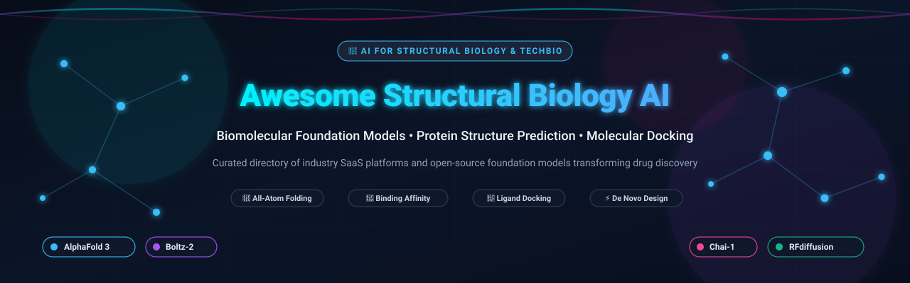
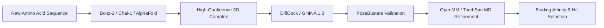

<p align="center">
  
</p>

<p align="center">
  <a href="https://github.com/ishandutta2007/Awesome-Awesome-Awesome"></a>
  <a href="https://discord.gg/jc4xtF58Ve"></a>
  <a href="https://github.com/ishandutta2007/Awesome-Structural-Biology-AI/stargazers"></a>
  <a href="https://github.com/ishandutta2007/Awesome-Structural-Biology-AI/network/members"></a>
  <a href="https://github.com/ishandutta2007/Awesome-Structural-Biology-AI/blob/main/LICENSE"></a>
  <a href="http://makeapullrequest.com"></a>
  <a href="https://github.com/ishandutta2007"></a>
</p>

---

# 🧬 Awesome Structural Biology & AI

A curated index of cutting-edge **SaaS platforms**, **foundation models**, and **open-source tools** powering modern **Structural Biology, Artificial Intelligence, and Computational Drug Discovery**.

From deep learning protein structure prediction (AlphaFold 3, Boltz-2, Chai-1) and all-atom molecular docking to physics-informed atomistic simulations and cryo-EM map reconstruction, this directory equips computational biologists, bioinformaticians, and biopharma researchers with the definitive state of the art.

---

## 📑 Table of Contents

- [🌐 Sector Overview & Market Dynamics](#-sector-overview--market-dynamics)
- [🏢 SaaS & Commercial Platforms](#-saas--commercial-platforms)
- [💻 Open-Source Foundation Models & Tools](#-open-source-foundation-models--tools)
- [🛠️ Pipeline Integration Recipes](#️-pipeline-integration-recipes)
- [🤝 How to Contribute](#-how-to-contribute)
- [⭐ Star History](#-star-history)
- [💖 Support & Community](#-support--community)
- [📜 License & Disclaimer](#-license--disclaimer)

---

## 🌐 Sector Overview & Market Dynamics

The global market for **AI in Structural Biology and Computational Drug Discovery** is estimated at **$1.9 billion to $2.2 billion in 2025/2026** and is forecasted to surpass **$8.7 billion by 2032**, expanding at a compound annual growth rate (**CAGR of ~28.6%**).

The market exhibits a distinct **barbell dynamic**:
- **Exploratory & Target Modeling Layer (Moderately Fragmented)**: Highly agile specialized biotechs, academic spin-offs, and open-source consortia rapidly pioneer novel architectures for allosteric pocket discovery, antibody-antigen design, macrocycle conformation, and covalent docking.
- **Foundation Model & Compute Infrastructure Layer (Highly Concentrated / Winner-Take-Most)**: Dominated by elite hyperscalers and capitalized TechBio giants (Google DeepMind/Alphabet, Schrödinger, Recursion). Here, petabyte-scale proprietary wet-lab robotic feedback loops, access to massive GPU superclusters, and multi-year biopharma co-development pipelines create immense competitive moats.

---

## 🏢 SaaS & Commercial Platforms

The following hosted platforms provide industrial-strength structural biology modeling, target discovery, and computational chemistry workflows. The table is sorted by **Company Valuation / Revenue (Descending)**.

| 🏷️ Platform | 🏢 Company & Valuation / Revenue | 🎯 Core Focus & Capabilities | 💵 Starting Tier Pricing | 🎁 Free Tier Limits |
| :--- | :--- | :--- | :--- | :--- |
| **[AlphaFold Server](https://alphafoldserver.com/)** | **Alphabet Inc. / Google DeepMind**<br>📊 *Valuation: ~$2.1T+*<br>📈 *Revenue: ~$350B/yr* | Hosted AlphaFold 3 service for folding multi-molecular assemblies (proteins, DNA, RNA, ligands, ions, chemical modifications). | **$0 / Academic Free**<br>(Commercial enterprise use strictly negotiated via DeepMind / Isomorphic Labs partnerships) | **Free for Academic Use**:<br>• **20 predictions per calendar day**<br>• Max 2,048 tokens per complex<br>• Max 10 distinct entities per job |
| **[Recursion OS & LOWE](https://www.recursion.com/)** | **Recursion Pharmaceuticals**<br>📊 *Market Cap: ~$2.2B (NASDAQ: RXRX)*<br>📈 *Revenue: ~$54.9M TTM* | Industrialized TechBio phenomics engine paired with LOWE generative chemistry LLM for drug target validation. | **$50,000/year**<br>(Exploratory biotech platform seat or multi-million milestone co-development deals) | **30-Day Sandbox Pilot**:<br>• Access for pre-qualified research partners<br>• Unlimited access to public BioHive/PhenoMap datasets |
| **[Schrödinger PyMOL](https://pymol.org/)** | **Schrödinger, Inc.**<br>📊 *Market Cap: ~$1.6B (NASDAQ: SDGR)*<br>📈 *Revenue: ~$215M/yr* | Industry-standard 3D molecular visualization system, high-resolution rendering, electron density mapping, and docking analysis. | **$500/year** (Academic)<br>**$2,100/year** (Commercial seat for small biotech ≤25 employees) | **Free Educational Tier**:<br>• **Free ($0)** for full-time students/teachers for classroom instruction<br>• **30-day fully functional** commercial evaluation trial |
| **[DNAnexus Titan & Apollo](https://www.dnanexus.com/)** | **DNAnexus (Blackstone)**<br>📊 *Valuation: ~$1.3B*<br>📈 *Revenue: ~$75M/yr* | Secure biomedical informatics platform for multi-omics analytics, population-scale genomics, and structural target analysis. | **$1,000/month** ($12,000/yr)<br>(Base platform license + cloud compute/storage consumption pass-through) | **90-Day Trial Credits**:<br>• **£40 usage credits** via UK Biobank RAP<br>• **30-day sandbox pilot** with $250 AWS cloud credits for biopharma |
| **[Pharma.AI (PandaOmics & Chemistry42)](https://insilico.com/)** | **Insilico Medicine**<br>📊 *Valuation: ~$1.2B (Unicorn)*<br>📈 *Revenue: ~$35M/yr* | End-to-end generative AI drug discovery suite: target identification (PandaOmics) and de novo molecular design (Chemistry42). | **$800/month** ($9,600/yr)<br>(Starting tier for PandaOmics single researcher seat; Chemistry42 begins at ~$3,500/mo) | **14-Day Free Evaluation**:<br>• 14 days access to PandaOmics with up to 5 disease target queries<br>• 7-day trial on Science42 DORA assistant |
| **[Cradle Bio](https://cradle.bio/)** | **Cradle**<br>📊 *Valuation: ~$100M ($24M Series A)*<br>📈 *Revenue: ~$5M/yr* | Generative protein design and sequence optimization platform focused on improving stability, solubility, and expression yields. | **$500/month** ($6,000/yr)<br>(Team tier subscription including model fine-tuning) | **14-Day Free Trial**:<br>• Full platform UI exploration<br>• Up to 3 candidate sequence design runs<br>• Basic predicted stability scores |
| **[Rosetta Commons (ROSIE)](https://www.rosettacommons.org/)** | **Rosetta Consortium / UW CoMotion**<br>📊 *Consortium Value: ~$50M+*<br>📈 *Revenue: ~$8M/yr royalties* | Macromolecular modeling, protein-protein docking, loop design, and free energy perturbation scoring algorithms. | **$15,000/year**<br>(Commercial license for biotechs <100 employees; $35,000–$70,000/yr for large enterprise) | **Free Forever (Academic)**:<br>• ROSIE server free for accredited non-profits<br>• Capped at **10 concurrent active queue jobs** and max **1,000 decoys/CPU hours** per run |
| **[Nanome XR](https://nanome.ai/)** | **Nanome Inc.**<br>📊 *Valuation: ~$25M*<br>📈 *Revenue: ~$3M/yr* | Immersive Virtual Reality (VR) and spatial computing workspace for collaborative 3D structural biology and drug design. | **$199/month per user**<br>($2,388/year professional annual license) | **14-Day Free Trial**:<br>• 14-day fully featured VR trial<br>• Up to 3 concurrent collaborative headsets<br>• Access to standard PDB viewer and docking tools |

---

## 💻 Open-Source Foundation Models & Tools

This section highlights the most influential open-source biomolecular repositories, foundation models, and molecular mechanics engines. 

The list is sorted by **GitHub_Stars (Descending)**, with live Stars_Badges linking directly to each repository's stargazers page:

---

### 1. [AlphaFold 2](https://github.com/google-deepmind/alphafold) [](https://github.com/google-deepmind/alphafold/stargazers)
- **License**: Apache-2.0
- **Summary**: Google DeepMind's seminal deep learning system that solved the 50-year protein folding challenge. Uses Evoformer attention blocks and structural modules over multiple sequence alignments (MSAs) to predict 3D atomic coordinates directly from primary amino acid sequences with experimental accuracy.
- **Install / Usage**:
  ```bash
  git clone https://github.com/google-deepmind/alphafold.git
  docker build -f docker/Dockerfile -t alphafold .
  ```

---

### 2. [DeepChem](https://github.com/deepchem/deepchem) [](https://github.com/deepchem/deepchem/stargazers)
- **License**: MIT
- **Summary**: The premier open-source deep learning framework for chemistry, materials science, and biology. Provides batteries-included pipelines for molecular property prediction, graph neural networks (GNNs), protein-ligand binding affinity scoring, and quantum chemistry computations.
- **Install / Usage**:
  ```bash
  pip install deepchem
  ```

---

### 3. [BioGPT](https://github.com/microsoft/BioGPT) [](https://github.com/microsoft/BioGPT/stargazers)
- **License**: MIT
- **Summary**: Microsoft's domain-specific generative language model pre-trained on millions of biomedical literature items (PubMed). Excels at relation extraction, biological question answering, document classification, and structural functional annotation mining.
- **Install / Usage**:
  ```bash
  pip install transformers sacremoses
  ```

---

### 4. [Boltz-2 & Boltz-1](https://github.com/jwohlwend/boltz) [](https://github.com/jwohlwend/boltz/stargazers)
- **License**: MIT (Permissive for Academic & Commercial Use)
- **Summary**: A state-of-the-art all-atom biomolecular foundation model. Boltz-1 was the first fully open-source system to approach AlphaFold3 accuracy across proteins, RNA, DNA, and ligands. Boltz-2 jointly predicts complex 3D structures and binding affinities (log10 IC50), reaching physics-based Free Energy Perturbation (FEP) precision at 1,000x faster speeds.
- **Install / Usage**:
  ```bash
  pip install "boltz[cuda]" -U
  boltz predict input.yaml --use_msa_server
  ```

---

### 5. [ESM (ESMFold & ESM-2)](https://github.com/facebookresearch/esm) [](https://github.com/facebookresearch/esm/stargazers)
- **License**: MIT
- **Summary**: Evolutionary Scale Modeling from Meta AI. Includes ESM-2 (up to 15B parameter protein language model) and ESMFold, which performs end-to-end atomic structure prediction directly from single sequences without requiring multiple sequence alignments, delivering up to 60x faster inference than AlphaFold2.
- **Install / Usage**:
  ```bash
  pip install fair-esm
  ```

---

### 6. [OpenFold](https://github.com/aqlaboratory/openfold) [](https://github.com/aqlaboratory/openfold/stargazers)
- **License**: Apache-2.0
- **Summary**: A trainable, memory-efficient, GPU-optimized PyTorch reproduction of AlphaFold2. Serves as the computational baseline for training new biomolecular models from scratch. Supports SoloSeq single-sequence mode and reduced-memory chunking for long macromolecular chains.
- **Install / Usage**:
  ```bash
  git clone https://github.com/aqlaboratory/openfold.git
  conda env create -f environment.yml
  ```

---

### 7. [RFdiffusion](https://github.com/RosettaCommons/RFdiffusion) [](https://github.com/RosettaCommons/RFdiffusion/stargazers)
- **License**: BSD-3-Clause
- **Summary**: Developed by the Baker Lab, RFdiffusion adapts generative diffusion models to de novo macromolecular design. Enables unconditional protein generation, motif scaffolding, symmetric oligomer design, enzyme active site engineering, and high-affinity target binder design from scratch.
- **Install / Usage**:
  ```bash
  git clone https://github.com/RosettaCommons/RFdiffusion.git
  python -m pip install -e .
  ```

---

### 8. [ColabFold](https://github.com/sokrypton/ColabFold) [](https://github.com/sokrypton/ColabFold/stargazers)
- **License**: MIT
- **Summary**: democratizes protein structure prediction by replacing slow homology searches with MMseqs2 web servers. Delivers 40–60x speedups for AlphaFold2 and AlphaFold-Multimer, making complex predictions readily accessible on standard local GPUs and cloud notebooks.
- **Install / Usage**:
  ```bash
  pip install "colabfold[alphafold]"
  colabfold_batch input.fasta ./results
  ```

---

### 9. [Chai-1](https://github.com/chaidiscovery/chai-lab) [](https://github.com/chaidiscovery/chai-lab/stargazers)
- **License**: Apache-2.0 (Academic & Commercial Use)
- **Summary**: Multi-modal biomolecular foundation model from Chai Discovery. Folds proteins alongside small molecules, nucleic acids, glycans, ions, and covalent modifications in a single unified diffusion model. Outputs confidence metrics (pLDDT, PAE, pTM, ipTM) and supports up to 2,048 tokens per complex.
- **Install / Usage**:
  ```bash
  pip install chai_lab
  chai-lab fold input.fasta output_dir/
  ```

---

### 10. [OpenMM](https://github.com/openmm/openmm) [](https://github.com/openmm/openmm/stargazers)
- **License**: MIT & LGPL-3.0
- **Summary**: High-performance, GPU-accelerated molecular dynamics toolkit. Supports modern force fields (AMBER, CHARMM, AMOEBA, OpenFF) and provides seamless Python bindings for integrating deep learning potentials and neural network force fields with classical mechanics.
- **Install / Usage**:
  ```bash
  conda install -c conda-forge openmm
  ```

---

### 11. [PyMOL Open-Source](https://github.com/schrodinger/pymol-open-source) [](https://github.com/schrodinger/pymol-open-source/stargazers)
- **License**: BSD-like Open-Source License
- **Summary**: The free, open-source codebase of the world's most widely used molecular visualization tool. Enables programmatic rendering, scriptable coordinate manipulation, hydrogen bond identification, and publication-quality 3D molecular figure creation.
- **Install / Usage**:
  ```bash
  conda install -c conda-forge pymol-open-source
  ```

---

### 12. [MDAnalysis](https://github.com/MDAnalysis/mdanalysis) [](https://github.com/MDAnalysis/mdanalysis/stargazers)
- **License**: GPL-3.0
- **Summary**: An object-oriented Python library to analyze trajectories from molecular dynamics simulations (GROMACS, CHARMM, NAMD, Amber, OpenMM). Provides fast coordinate extraction, root-mean-square deviation (RMSD), PCA, and hydrogen-bonding kinetics.
- **Install / Usage**:
  ```bash
  pip install --upgrade MDAnalysis
  ```

---

### 13. [DiffDock](https://github.com/gcorso/DiffDock) [](https://github.com/gcorso/DiffDock/stargazers)
- **License**: MIT
- **Summary**: Diffusion generative model over the degrees of freedom of ligand translation, rotation, and torsion angles. Treats flexible blind molecular docking as a generative reverse-diffusion process, achieving state-of-the-art pose prediction without requiring predefined binding pockets.
- **Install / Usage**:
  ```bash
  git clone https://github.com/gcorso/DiffDock.git
  python -m pip install -e .
  ```

---

### 14. [PaddleHelix](https://github.com/PaddlePaddle/PaddleHelix) [](https://github.com/PaddlePaddle/PaddleHelix/stargazers)
- **License**: Apache-2.0
- **Summary**: Baidu's machine learning toolkit for biocomputing. Features HelixFold (a highly optimized implementation of AlphaFold2) and pre-trained models for drug-target interaction (DTI), RNA secondary structure prediction, and ADMET profiling.
- **Install / Usage**:
  ```bash
  pip install paddlehelix
  ```

---

### 15. [GNINA 1.3](https://github.com/gnina/gnina) [](https://github.com/gnina/gnina/stargazers)
- **License**: Apache-2.0
- **Summary**: Deep learning framework for molecular docking and scoring. Employs 3D convolutional neural networks (CNNs) trained on CrossDocked benchmarks to rescore docked poses, evaluate binding affinities, and conduct high-throughput covalent and non-covalent virtual screening.
- **Install / Usage**:
  ```bash
  # Precompiled binary or Conda
  conda install -c conda-forge gnina
  ```

---

### 16. [OpenFold-3](https://github.com/aqlaboratory/openfold-3) [](https://github.com/aqlaboratory/openfold-3/stargazers)
- **License**: Apache-2.0
- **Summary**: Fully open-source reproduction and evolution of the AlphaFold3 architecture by the OpenFold consortium. Provides transparent, non-restrictive model weights and inference code for folding complex biomolecular assemblies containing modified amino acids, DNA/RNA, and small molecules.
- **Install / Usage**:
  ```bash
  git clone https://github.com/aqlaboratory/openfold-3.git
  ```

---

### 17. [BioNeMo Recipes](https://github.com/NVIDIA-BioNeMo/bionemo-recipes) [](https://github.com/NVIDIA-BioNeMo/bionemo-recipes/stargazers)
- **License**: Apache-2.0
- **Summary**: NVIDIA's enterprise-grade generative AI framework for drug discovery. Contains recipes for fine-tuning ESM-2, training MegaMolBART, running DiffDock inference on TensorRT, and scaling structural biology foundation models across distributed GPU clusters.
- **Install / Usage**:
  ```bash
  pip install bionemo-recipes
  ```

---

### 18. [OmegaFold](https://github.com/HeliXonProtein/OmegaFold) [](https://github.com/HeliXonProtein/OmegaFold/stargazers)
- **License**: Apache-2.0
- **Summary**: Fast single-sequence protein structure prediction model that leverages OmegaPLM language representations without requiring homology searches or multiple sequence alignments. Highly effective for orphan proteins and fast screening.
- **Install / Usage**:
  ```bash
  pip install git+https://github.com/HeliXonProtein/OmegaFold.git
  ```

---

### 19. [RELION](https://github.com/3dem/relion) [](https://github.com/3dem/relion/stargazers)
- **License**: GPL-2.0
- **Summary**: REgularised LIkelihood OptimisatioN for electron cryo-microscopy (Cryo-EM). The gold-standard Bayesian framework for single-particle 3D reconstruction, subtomogram averaging, and macromolecular dynamics analysis.
- **Install / Usage**:
  ```bash
  git clone https://github.com/3dem/relion.git
  cd relion && mkdir build && cd build && cmake .. && make -j 8
  ```

---

### 20. [ProDy](https://github.com/prody/ProDy) [](https://github.com/prody/ProDy/stargazers)
- **License**: MIT
- **Summary**: Comprehensive Python package for protein dynamics analysis. Combines Normal Mode Analysis (NMA), Anisotropic Network Models (ANM), and trajectory ensembles to evaluate conformational flexibility and allosteric communication.
- **Install / Usage**:
  ```bash
  pip install -U ProDy
  ```

---

### 21. [EasyDock](https://github.com/ci-lab-cz/easydock) [](https://github.com/ci-lab-cz/easydock/stargazers)
- **License**: MIT
- **Summary**: Modular and distributed molecular docking pipeline. Orchestrates multiple docking engines (AutoDock Vina, CarsiDock, SurfDock) in containerized Apptainer/Docker environments with built-in ligand protonation and PoseBusters pose validation.
- **Install / Usage**:
  ```bash
  pip install easydock
  ```

---

## 🛠️ Pipeline Integration Recipes

Modern computational structural biology pipelines combine complementary open-source and commercial engines to bridge sequence to biological efficacy:



1. **Structure Prediction**: Generate all-atom multi-complex structures with **Boltz-2** (MIT) or **Chai-1** (Apache-2.0).
2. **Flexible Docking**: Perform blind pose generation using **DiffDock**, followed by covalent docking and 3D CNN scoring using **GNINA 1.3**.
3. **Refinement & Thermodynamics**: Relax binding poses and compute stability using **OpenMM** GPU molecular dynamics.
4. **Interactive Analysis**: Visualize binding pockets and hydrogen-bond interactions using **PyMOL**.

---

## 🤝 How to Contribute

Contributions from researchers, software developers, and structural biologists are welcome!

1. **Fork the repository** to your GitHub account.
2. **Add or update an entry** in `README.md` maintaining consistent formatting:
   - For SaaS: Name, company, valuation/revenue, capabilities, exact starting tier price, and specific free tier limits.
   - For Open-Source: Repository link, live Stars_Badge `[](https://github.com/<owner>/<repo>/stargazers)`, license, description, and install snippet.
3. **Submit a Pull Request (PR)** with a concise summary of the change.

---

## ⭐ Star History

[](https://star-history.dera.page/#ishandutta2007/Awesome-Structural-Biology-AI&type=date&legend=top-left)

---

## 💖 Support & Community

Thank you for visiting and supporting **Awesome Structural Biology AI**! 

Open-source biology and generative AI are accelerating at an unprecedented pace. Maintaining high-quality directories, licensing guidelines, and vetted benchmarks takes ongoing community collaboration.

If you find this repository valuable:
- ⭐ **Star this repository** on GitHub to help fellow biologists and engineers discover it!
- 🍴 **Fork it** and submit pull requests with the latest models, tools, and benchmarks.
- 📢 **Share it** on LinkedIn, X/Twitter, Bluesky, or your laboratory's Discord/Slack workspace.
- ☕ **Support the curator & buy a coffee**: Back future updates directly via the [GitHub Sponsor Dashboard](https://github.com/sponsors/ishandutta2007).

---

## 📜 License & Disclaimer

- Distributed under the **MIT License**. See [`LICENSE`](file:///C:/Users/hp/Documents/Projects/Awesome-Structural-Biology-AI/LICENSE) for more information.
- **Disclaimer**: This curated list is for research and educational purposes. Always verify software licenses prior to commercial deployment—tools like **Boltz-2** and **Chai-1** offer permissive MIT/Apache-2.0 licenses for commercial discovery, whereas other models may impose non-commercial research restrictions. Computational predictions are estimates and require wet-lab experimental validation before therapeutic or clinical applications.
